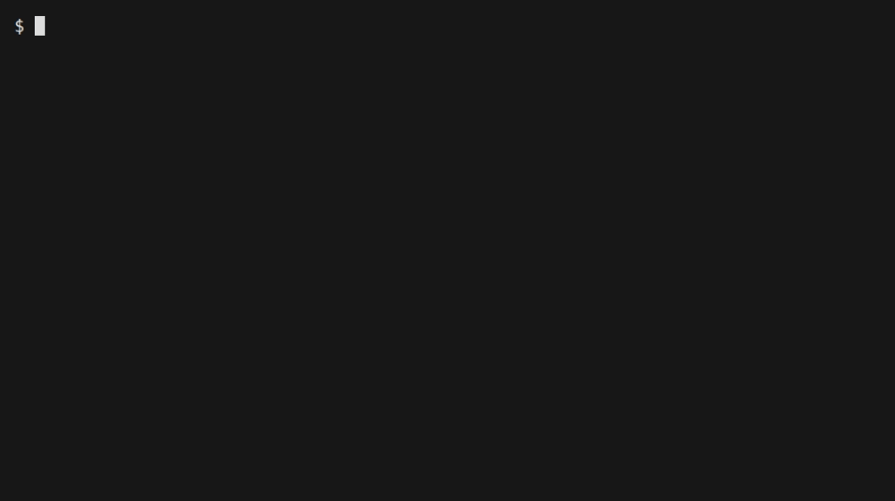

# quota-watch

Shows how much Claude Code and Codex quota you have left, for you and for agents or scripts that need to check before long work.



The demo uses a fictional status-line payload ([`docs/demo.tape`](docs/demo.tape)).

## Why use it

- **Agents can see Claude Code's limits.** Claude Code only passes `rate_limits` to your status-line command. quota-watch saves them to a file that anything can read.
- **Long jobs can stop before they hit the wall.** `remaining` exits non-zero when quota is low, stale, or unknown.
- **It fits your existing status line.** `dump` passes stdin straight through, so it chains in front of what you already run.
- **One stable JSON shape for both providers.** Claude and Codex report through the same fields.
- **No runtime dependencies for the CLI.** It needs only Node. The optional OpenCode TUI plugin does have dependencies.

## Install

quota-watch is not published on npm. Run it from a clone:

```sh
git clone https://github.com/IvanSevill/quota-watch.git
cd quota-watch
node usage.mjs
```

To get `quota-watch` and `usage` commands on your `PATH`, also run `npm install -g .`.

Then connect it to Claude Code in `~/.claude/settings.json`. Pick one:

```jsonc
// Keep your current status line
{ "statusLine": { "type": "command",
  "command": "node \"/path/to/quota-watch/usage.mjs\" dump | sh ~/.claude/statusline-command.sh" } }
```

```jsonc
// Use quota-watch as your status line
{ "statusLine": { "type": "command",
  "command": "node \"/path/to/quota-watch/usage.mjs\" statusline" } }
```

Data is saved to `~/.claude/usage.json` (override with `CLAUDE_USAGE_FILE`). Codex needs no setup beyond an installed `codex` command or local session files.

## Usage

```console
$ node usage.mjs
AI quota
  session    ████████░░░░░░░░░░░░   41% left   resets in 3h 43m
  week       ██████████████████░░   90% left   resets in 6d 18h
```

Guard a long job:

```sh
node usage.mjs remaining claude --min 15 || { echo "Not enough quota; try after the reset."; exit 1; }
```

| Command | Result |
|---|---|
| `usage.mjs` | Claude report for people |
| `usage.mjs --json` | Claude `session` and `week` values for scripts |
| `usage.mjs remaining <claude\|codex> --json` | Stable result for either provider |
| `usage.mjs --provider codex` | Codex report: app-server, then session files, then cache |
| `usage.mjs dump` / `statusline` | Save status-line data and pass it on, or draw a bar |

> **Guard with `remaining` or `--quiet --min N`.** Both exit `1` on low quota and `2` when data is missing, stale, or unknown. Without `--quiet`, the plain report and `--json` still exit `0` in those cases.

The [guide](docs/GUIDE.md) covers every option and exit code, the snapshot schema, the OpenCode plugins, and how to tell an agent about the tool.

## Privacy

- The code has no HTTP client and reads no API keys, cookies, or credential files.
- Claude data comes only from the usage file your status line writes.
- For Codex, it starts your already authenticated `codex app-server`. What that process contacts is outside this tool.
- The session-file fallback parses `~/.codex/sessions/**/rollout-*.jsonl` and keeps only `rate_limits` from `token_count` events. Prompts and responses are not returned.
- Successful readings are cached in `~/.claude/quota-cache.json`.

## Status and limits

- **Claude and Codex only.** Gemini and OpenAI are not implemented, and `--provider` rejects them.
- **Claude data is only as fresh as your last status-line render.** Readings older than 15 minutes count as stale.
- **Nothing to report at first.** Claude Code omits `rate_limits` until the first API response of a session.
- **Percentages, not token counts.** The tool reports what each provider exposes.
- **Testing:** `npm test` passes on Node 22 on Linux and uses fakes. The display model is tested, but the OpenCode TUI entrypoint has no automated test.

```sh
npm test
```

## License

[MIT](LICENSE)
